<div align="center">
  
</div>

<p align="center">
  <em>Infraestructura propia, decisiones medidas y nada que no pueda revertir.</em>
</p>

<p align="center">
  
  
  
  
  
  <br />
  
  
  
  
  
</p>

---

## whoami

Soy Juarman. Trabajo en sistemas: los monto, los rompo y los vuelvo a levantar cuando ya sé por qué fallaban.

Mi terreno es Windows por dentro —shell, servicios, arranque, controladores— y la infraestructura que hay detrás: un hipervisor Proxmox, contenedores, proxy inverso, copias que de verdad restauran y una VPN que cierra la puerta desde fuera.

No tengo un CV de certificados. Tengo un historial de sesiones, un vault con lo aprendido y un puñado de herramientas propias que uso todos los días.

---

## cómo trabajo

| Principio | Qué significa |
|---|---|
| **Primero mido, después toco** | Un cambio se justifica con números de antes y de después, no con una impresión. |
| **Si no es reversible, no es un cambio** | Copia, punto de restauración o la versión anterior al lado. Volver atrás tiene que seguir siendo posible. |
| **Prefiero lo pequeño a lo completo** | Una herramienta que entiendo entera vale más que una suite de la que uso el 5 %. |
| **Documento el error, no solo la solución** | Lo que no está escrito se repite. |

---

## el laboratorio

Un hipervisor, cinco contenedores y una norma: cada servicio con un trabajo claro y una forma de volver atrás.

| Contenedor | Qué corre dentro |
|---|---|
| `docker` | Hermes Agent, Portainer y la pila de observabilidad (Promtail + Loki) |
| `tunnel` | Cloudflare Tunnel: servicios publicados sin abrir un solo puerto |
| `utils` | PriceBuddy, ChangeDetection y las herramientas OSINT |
| `vpn` | pasarela VPN para salida y entrada cifrada |
| `vault` | Vaultwarden con copias comprimidas y siete días de retención |

```text
proxmox
├── docker ────── hermes · portainer · loki
├── tunnel ────── cloudflare tunnel
├── utils ─────── pricebuddy · changedetection · osint
├── vpn ───────── pasarela cifrada
└── vault ─────── vaultwarden (copia diaria, 7 días)
```

Cada servicio tiene un límite. Lo que no aporta se apaga; lo que se apaga se documenta.

---

## el equipo

No trabajo solo. Hay un tablero Kanban y cinco agentes con roles fijos: cada tarjeta entra por investigación y no sale hasta que alguien la ha revisado.

| Rol | Qué hace |
|---|---|
| **Merovingio** | investiga: viabilidad, alternativas y coste real |
| **Arquitecto** | decide estructura, stack y qué se descarta |
| **Constructor** | implementa, prueba y deja el build en verde |
| **Revisor** | audita código, seguridad y rendimiento |
| **Desbloqueador** | rescata lo que lleva demasiado tiempo atascado |

```text
research  →  design  →  build  →  review  →  deploy
```

El orquestador es Hermes Agent y el tablero vive en la misma infraestructura que todo lo demás. Los agentes trabajan con las mismas reglas que yo: medir, no inventar y dejar rastro.

---

## ia local

16 GB de VRAM y una regla: lo que no necesita salir de casa, no sale.

- **llama.cpp** compilado contra Vulkan, con modelos GGUF en cuantizaciones ajustadas.
- **Modelos MoE con offload parcial**: la parte caliente en VRAM, el resto en RAM.
- Un **router propio con watchdog** que decide qué motor atiende cada petición.
- **Comparación A/B de motores** antes de cambiar nada: la última migración dio un 10 % más de velocidad y se quedó por eso, no por novedad.

La IA local no es una demo. Es la razón por la que puedo trabajar con datos que no subiría a una API.

---

## proyectos

| Proyecto | Qué resuelve | Stack |
|---|---|---|
| **StartRed** | Color propio en los dos elementos del shell que Windows no deja tocar: el logo de Inicio y la barrita de app abierta | C++/WinRT · C# |
| **Lumen** | Estudio de fondos procedurales: genera, previsualiza y exporta | C# / .NET |
| **granalume** | Reconstrucción 1:1 de una app de fondos de la Store, medida contra el original | Python · pywebview · PyInstaller |
| **NZXT Lite** | RGB de NZXT por HID, con los efectos en el firmware; sustituye a CAM | C# · NativeAOT |
| **TaskbarMono** | Pack de iconos monocromos y un vigilante que transforma cualquier app anclada | Python · ICO |
| **SplashLite** | Overlay de arranque que tapa el escritorio desnudo y se funde cuando todo ha cargado | Win32 · GDI+ |
| **SoundDeck Replacement** | Reemplazo de la app abandonada de mi micrófono, con captura WASAPI | C# · APO |
| **Win2Linux** | Inventaría el equipo, clasifica aplicaciones y prepara la migración con copias verificadas | Python · Rust |
| **FastSize** | Mide tamaños leyendo la MFT de NTFS en crudo, sin recorrer carpetas | C# · Win32 |

**En pausa, sin repositorio público todavía:** un planificador de turnos en React y un stack OSINT autoalojado, ambos de julio. Están, pero no los presento como vivos.

**Herramientas, no proyectos propios:** REA (Ghidra + MCP) y Craft Anything los uso para analizar software ajeno; el código no es mío.

---

## stack

```text
sistemas      proxmox · lxc · docker · systemd · zfs · nginx
red           cloudflare tunnel · wireguard · dns · firewalls
lenguajes     python · c# · c++ · typescript · rust · sql
windows       win32 · winrt · hooks · xaml · ntfs/mft · tareas programadas
hardware      timings de ram · bios · temperaturas · memtest
ia            llama.cpp · gguf · moe · rag · mcp
análisis      ghidra · rea · frida · rizin · cdp
```

---

## criterio de diseño

| Pieza | Valor |
|---|---|
| Fondo | `#07080B` |
| Texto | `#F2F5F9` |
| Acento | `#00E5FF`, uno solo y con moderación |
| Tipografía | sistema para interfaz, monoespaciada para datos |
| Regla | menos color, más aire. Si dudo, lo quito |

Vengo del neón y del glassmorphism. Sigo usando el mismo negro, pero cada vez me interesa más lo que no se ve: jerarquía, contraste y espacio.

---

## ahora

- Afinar la IA local: cuantizaciones, offload y un router que elija motor sin que yo tenga que pensarlo.
- Quitar del PC el último software de fabricante que pide más de lo que da.
- Llevar todo a la medición: temperaturas, latencias, tokens por segundo y vatios.

---

## fuera de la terminal

Guitarra eléctrica y amplificadores simulados, con una carpeta de presets que va del metal español al rock alternativo. Algún juego de mundo abierto y algún emulador cuando el día ha sido largo. Y un vault de Obsidian donde acaba todo lo que aprendo.

---

<p align="center">
  <samp>«How to learn about everything.»</samp>
</p>
